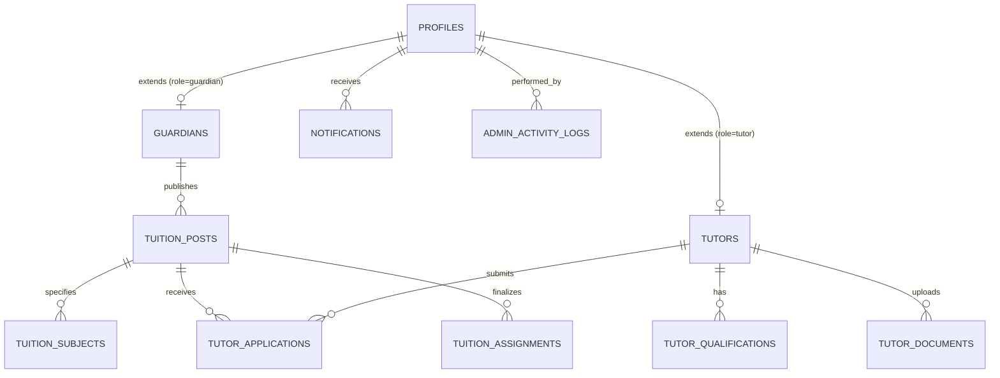

# Tuition Chai — Database Architecture & Schema Specification
**Target Platform:** Supabase PostgreSQL Free Tier  
**Location Focus:** Chattogram & Bangladesh  
**Security Tier:** Row Level Security (RLS) Enforced Relational Schema

---

## 1. Architectural Overview & Entity-Relationship Model

---

## 2. Relational Tables & Enums

### 2.1 Core Types & Enums
- `user_role`: `'guardian'`, `'tutor'`, `'super_admin'`
- `account_status`: `'active'`, `'suspended'`, `'pending_approval'`
- `verification_status`: `'unverified'`, `'pending_review'`, `'verified'`, `'rejected'`
- `tuition_status`: `'draft'`, `'pending_approval'`, `'published'`, `'in_progress'`, `'completed'`, `'closed'`, `'rejected'`
- `application_status`: `'submitted'`, `'under_review'`, `'shortlisted'`, `'interview_requested'`, `'accepted'`, `'rejected'`, `'withdrawn'`

---

### 2.2 Table Definitions

#### `profiles`
Primary identity linked 1:1 with `auth.users(id)`.
- `id` (UUID, PK, references `auth.users(id)` ON DELETE CASCADE)
- `email` (TEXT, UNIQUE, NOT NULL)
- `phone` (TEXT, UNIQUE, NOT NULL)
- `full_name` (TEXT, NOT NULL)
- `role` (user_role, NOT NULL DEFAULT 'guardian')
- `avatar_url` (TEXT)
- `preferred_language` (VARCHAR(5) DEFAULT 'en')
- `status` (account_status DEFAULT 'active')
- `created_at` (TIMESTAMPTZ DEFAULT NOW())
- `updated_at` (TIMESTAMPTZ DEFAULT NOW())

#### `guardians`
Guardian profile details.
- `id` (UUID, PK, references `profiles(id)` ON DELETE CASCADE)
- `primary_location_area` (TEXT NOT NULL)
- `detailed_address` (TEXT)
- `emergency_contact` (TEXT)
- `notes` (TEXT)

#### `tutors`
Tutor professional and academic profile.
- `id` (UUID, PK, references `profiles(id)` ON DELETE CASCADE)
- `university` (TEXT NOT NULL)
- `department` (TEXT NOT NULL)
- `current_academic_level` (TEXT NOT NULL)
- `current_year_semester` (TEXT NOT NULL)
- `teaching_experience` (TEXT NOT NULL)
- `expected_salary` (NUMERIC(10,2) NOT NULL)
- `preferred_teaching_method` (TEXT NOT NULL)
- `preferred_locations` (TEXT[] NOT NULL DEFAULT '{}')
- `preferred_classes` (TEXT[] NOT NULL DEFAULT '{}')
- `preferred_subjects` (TEXT[] NOT NULL DEFAULT '{}')
- `bio` (TEXT)
- `rating` (NUMERIC(3,2) DEFAULT 5.0)
- `reviews_count` (INTEGER DEFAULT 0)
- `verification_status` (verification_status DEFAULT 'unverified')
- `verified_at` (TIMESTAMPTZ)
- `verified_by` (UUID references `profiles(id)`)

#### `tutor_qualifications`
Academic degree history (SSC, HSC, Bachelor).
- `id` (UUID, PK, gen_random_uuid())
- `tutor_id` (UUID, NOT NULL references `tutors(id)` ON DELETE CASCADE)
- `exam_name` (TEXT NOT NULL)
- `result_gpa` (TEXT NOT NULL)
- `passing_year` (INTEGER)
- `institution_name` (TEXT)

#### `tutor_documents`
Private encrypted storage for student ID and transcripts.
- `id` (UUID, PK, gen_random_uuid())
- `tutor_id` (UUID, NOT NULL references `tutors(id)` ON DELETE CASCADE)
- `document_type` (TEXT NOT NULL) -- 'student_id', 'hsc_transcript', 'nid'
- `storage_path` (TEXT NOT NULL)
- `verification_status` (verification_status DEFAULT 'pending_review')
- `rejection_reason` (TEXT)
- `uploaded_at` (TIMESTAMPTZ DEFAULT NOW())
- `reviewed_at` (TIMESTAMPTZ)

#### `tuition_posts`
Tuition requirements posted by guardians.
- `id` (UUID, PK, gen_random_uuid())
- `tuition_code` (TEXT UNIQUE NOT NULL) -- e.g. TC-2026-001
- `guardian_id` (UUID NOT NULL references `guardians(id)` ON DELETE CASCADE)
- `student_class` (TEXT NOT NULL)
- `curriculum` (TEXT NOT NULL)
- `location_area` (TEXT NOT NULL)
- `detailed_address` (TEXT)
- `monthly_budget` (NUMERIC(10,2) NOT NULL)
- `days_per_week` (INTEGER NOT NULL DEFAULT 4)
- `teaching_method` (TEXT NOT NULL DEFAULT 'Home Tutoring')
- `preferred_tutor_gender` (TEXT DEFAULT 'Any')
- `preferred_tutor_qualification` (TEXT)
- `detailed_requirements` (TEXT)
- `status` (tuition_status DEFAULT 'pending_approval')
- `is_featured` (BOOLEAN DEFAULT FALSE)
- `created_at` (TIMESTAMPTZ DEFAULT NOW())
- `approved_at` (TIMESTAMPTZ)
- `approved_by` (UUID references `profiles(id)`)

#### `tutor_applications`
Applications sent by tutors.
- `id` (UUID, PK, gen_random_uuid())
- `tuition_post_id` (UUID NOT NULL references `tuition_posts(id)` ON DELETE CASCADE)
- `tutor_id` (UUID NOT NULL references `tutors(id)` ON DELETE CASCADE)
- `proposed_salary` (NUMERIC(10,2) NOT NULL)
- `application_message` (TEXT NOT NULL)
- `status` (application_status DEFAULT 'submitted')
- `created_at` (TIMESTAMPTZ DEFAULT NOW())
- `updated_at` (TIMESTAMPTZ DEFAULT NOW())
- **Constraint:** `UNIQUE(tuition_post_id, tutor_id)` (Guarantees duplicate application prevention)

#### `admin_activity_logs`
Immutable audit trail.
- `id` (UUID, PK, gen_random_uuid())
- `admin_id` (UUID NOT NULL references `profiles(id)`)
- `action_type` (TEXT NOT NULL) -- 'VERIFY_TUTOR', 'APPROVE_TUITION', 'SUSPEND_ACCOUNT'
- `target_entity` (TEXT NOT NULL)
- `target_id` (UUID NOT NULL)
- `details` (JSONB)
- `ip_address` (TEXT)
- `created_at` (TIMESTAMPTZ DEFAULT NOW())

---

## 3. Database Indexes for Performance & Search
- `CREATE INDEX idx_tuition_posts_status ON tuition_posts(status);`
- `CREATE INDEX idx_tuition_posts_location ON tuition_posts(location_area);`
- `CREATE INDEX idx_tuition_posts_class ON tuition_posts(student_class);`
- `CREATE INDEX idx_tutors_verification ON tutors(verification_status);`
- `CREATE INDEX idx_tutor_applications_composite ON tutor_applications(tuition_post_id, tutor_id);`
